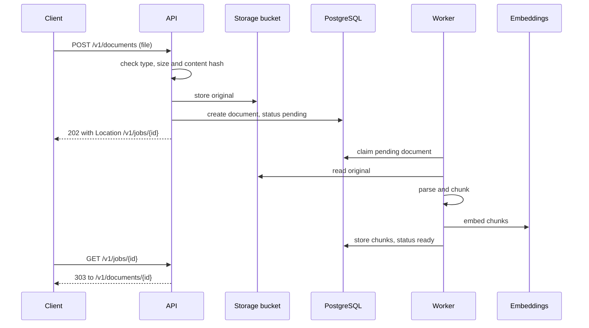

# rag

A document ingestion service for retrieval-augmented generation. Upload PDF, DOCX, plain text or Markdown files over HTTP. The service stores the original, extracts the text, splits it into chunks, embeds the chunks and saves them in PostgreSQL with pgvector, all in the background with a status you can poll.

**Status:** ingestion and document management are built. Retrieval, answering and authentication are not built yet.

## Features

- Upload PDF (text layer), DOCX, TXT and Markdown files
- File type detected from the file content and checked against the extension
- Background ingestion that survives restarts, with `pending`, `processing`, `ready` and `failed` document states
- Duplicate detection by file content, so the same file is never ingested twice
- Originals kept in a private Supabase Storage bucket
- Hybrid retrieval in one SQL statement: HNSW cosine vector search and Postgres full-text search, fused with Reciprocal Rank Fusion, with weights, candidate counts and result count as settings
- Cited answers from the documents only, as JSON or a server-sent event stream, with an explicit "not found" instead of invented answers
- A LangGraph pipeline that routes each question with Claude and rewrites follow-ups into standalone search queries
- Claude (Anthropic) for answers, routing, grading and rewriting, with retries and backoff on rate limits. Agents built with `agent_middleware` also get Anthropic prompt caching
- LangSmith tracing with secrets and model reasoning removed, and a RAGAS evaluation command
- Configurable limits for upload size, PDF pages, extracted text and DOCX expansion
- Versioned API under `/v1`: uploads return `202` with a job to poll, lists use cursors, and a retried upload can carry an `Idempotency-Key`
- Every error is an RFC 9457 `application/problem+json` document, with no internal detail on server errors
- Embeddings from Jina or a local sentence-transformers model, behind one interface

## How it works



The worker claims documents with row locking, so several instances can run without processing the same document twice. A document left in `processing` after a crash is reclaimed after a timeout.

## Requirements

- Python 3.11 or newer and [uv](https://docs.astral.sh/uv/)
- A PostgreSQL database with the `pgvector` extension, such as a Supabase project
- A Supabase project for file storage
- A [Jina](https://jina.ai) API key, or a machine that can run the local embedding model

## Quick start

```bash
git clone https://github.com/manohar-kumar1/rag.git
cd rag
cp .env.example .env
uv sync
```

Fill every variable in `.env` (see [Configuration](#configuration)), then prepare the database and storage and start the service:

```bash
uv run python -m app.db.migrate
uv run python -m app.storage.bucket_setup
uv run uvicorn app.main:app --reload
```

Open `http://localhost:8000/docs` for the interactive API description. Set `WORKER_ENABLED=true` so uploaded documents are ingested.

## Configuration

All settings come from environment variables or a `.env` file. Every variable is required except the two Anthropic ones, and none has a built-in default, so the service refuses to start when one is missing or invalid.

### Database

| Variable | Description |
|---|---|
| `DATABASE_URL` | PostgreSQL connection string. Use a direct or session-mode connection, not transaction mode |
| `DB_POOL_MIN_SIZE` | Smallest number of pooled connections |
| `DB_POOL_MAX_SIZE` | Largest number of pooled connections |
| `DB_POOL_MAX_LIFETIME_SECONDS` | Connections older than this are replaced |
| `DB_POOL_TIMEOUT_SECONDS` | How long to wait for a connection and for the pool to open |

### Embeddings

| Variable | Description |
|---|---|
| `EMBEDDING_PROVIDER` | `jina` or `local` |
| `EMBEDDING_MODEL` | Model name for the chosen provider |
| `EMBEDDING_DIMENSION` | Vector size. Must match the database column. At most 2000 |
| `JINA_API_KEY` | Jina API key |
| `JINA_BASE_URL` | Jina API base URL |
| `JINA_BATCH_SIZE` | Chunks sent per request |
| `JINA_MAX_RETRIES` | Retries on rate limits and server errors |
| `JINA_RETRY_BACKOFF_SECONDS` | First retry delay, doubled each attempt |
| `JINA_TIMEOUT_SECONDS` | Request timeout |

Changing the embedding model or dimension means re-embedding every document.

### Ingestion and limits

| Variable | Description |
|---|---|
| `CHUNK_MIN_TOKENS` | Sections smaller than this are merged into the previous one |
| `CHUNK_MAX_TOKENS` | Largest chunk, in estimated tokens (4 characters each). Tables and code are not split unless they are larger |
| `CHUNK_OVERLAP_TOKENS` | Tokens repeated between neighbouring text chunks of one section. Must be smaller than the maximum |
| `PARENT_MAX_TOKENS` | A matched chunk is expanded to its whole section when the section is no larger than this. 0 turns expansion off |
| `PDF_PARSER` | `llamaparse` reads headings, tables, lists and scanned pages through LlamaParse. `pypdf` reads flat text locally |
| `LLAMAPARSE_TIER`, `LLAMAPARSE_VERSION` | Parse tier and a pinned version, so parses are repeatable and cacheable |
| `LLAMAPARSE_TIMEOUT_SECONDS` | Timeout for each request to LlamaParse, including the upload of a large PDF |
| `LLAMAPARSE_MAX_RETRIES` | Retries per request. Keep it low: a retried upload can start a second paid job |
| `LLAMAPARSE_API_KEY` | LlamaParse key. Required when `PDF_PARSER` is `llamaparse` |
| `MAX_UPLOAD_BYTES` | Largest accepted upload, enforced before the file is fully read |
| `MAX_PDF_PAGES` | Most pages read from one PDF |
| `MAX_EXTRACTED_CHARS` | Most text kept from one document |
| `DOCX_MAX_UNCOMPRESSED_BYTES` | Largest size a DOCX may expand to |

### Storage

| Variable | Description |
|---|---|
| `SUPABASE_URL` | Supabase project URL |
| `SUPABASE_SECRET_KEY` | Server-side Supabase key. Never expose it to a browser |
| `STORAGE_BUCKET` | Name of the private bucket for original files |
| `STORAGE_TIMEOUT_SECONDS` | Storage request timeout. Size it so `MAX_UPLOAD_BYTES` can be sent at your slowest upload speed |

### Worker and API

| Variable | Description |
|---|---|
| `WORKER_ENABLED` | Run the ingestion worker inside this process |
| `WORKER_POLL_INTERVAL_SECONDS` | How often the worker looks for pending documents |
| `WORKER_CONCURRENCY` | Documents processed at the same time per process |
| `WORKER_STALE_AFTER_SECONDS` | A `processing` document older than this is picked up again |
| `CORS_ORIGINS` | Comma-separated browser origins allowed to call the API |
| `DOCS_ENABLED` | Serve `/docs` and `/redoc`. Set `false` in production |
| `JOB_RETRY_AFTER_SECONDS` | Polling hint sent in the `Retry-After` header while a job is unfinished |
| `IDEMPOTENCY_TTL_SECONDS` | How long a finished `Idempotency-Key` is remembered |
| `IDEMPOTENCY_LOCK_SECONDS` | How long a key counts as in progress if the first request never finishes |
| `RRF_K` | Reciprocal Rank Fusion constant. Larger values flatten the difference between ranks |
| `RETRIEVAL_VECTOR_WEIGHT` | Weight of the vector search in the fused score. `0` switches that side off |
| `RETRIEVAL_FTS_WEIGHT` | Weight of the full-text search in the fused score. `0` switches that side off |
| `RETRIEVAL_VECTOR_CANDIDATES` | Chunks the vector search contributes before fusion, at most 1000 |
| `RETRIEVAL_FTS_CANDIDATES` | Chunks the full-text search contributes before fusion |
| `RETRIEVAL_TOP_K` | Chunks returned after fusion |

### Language models

| Variable | Description |
|---|---|
| `ANTHROPIC_API_KEY` | Anthropic API key |
| `ANTHROPIC_MODEL` | Claude model for answers, routing, grading, rewriting and planning, for example `claude-haiku-5-5` |
| `LLM_TIMEOUT_SECONDS` | Timeout for one model call |
| `LLM_MAX_OUTPUT_TOKENS` | Cap on the tokens a model may generate per call |
| `LLM_MAX_RETRIES` | Retries after the first attempt for rate limits and other retryable model errors |
| `LLM_RETRY_INITIAL_SECONDS` | First backoff delay. Later delays grow exponentially with jitter |
| `LLM_RETRY_MAX_SECONDS` | Longest backoff delay |

### Answering features

| Variable | Description |
|---|---|
| `AGENT_MAX_SUBQUESTIONS` | Most sub-questions a complex question is split into |
| `AGENT_MAX_ITERATIONS` | Most retrievals one complex question may use. When reached, the answer names what is missing |
| `AGENT_MAX_REWRITES` | Times one sub-question's search may be reworded after weak results |
| `AGENT_GRADE_THRESHOLD` | Probability, between 0 and 1, that the passages answer a sub-question before the loop moves on |
| `MASK_PATTERNS` | JSON object of name to regular expression. Matches in questions are replaced by `[name]` before any model or log sees them |
| `GROUNDEDNESS_CHECK_ENABLED` | Check each answer against its cited passages before returning it |
| `GROUNDEDNESS_THRESHOLD` | Probability, between 0 and 1, below which an answer is replaced by "could not verify" |
| `CONVERSATION_MAX_TURNS` | Earlier turns of a thread used for a follow-up |
| `CONVERSATION_RETENTION_SECONDS` | Age after which stored conversation turns are deleted |
| `RERANK_ENABLED` | Re-score retrieved chunks with the Jina reranker |
| `RERANK_MODEL` | Jina reranker model. Required when reranking is on |
| `RERANK_CANDIDATES` | Chunks retrieved for the reranker to score |
| `RERANK_TOP_N` | Chunks kept after reranking |
| `RERANK_MAX_RETRIES` | Retries when the reranker answers 429 or a server error. A rate-limited query waits for them, then keeps the retrieval order |
| `RERANK_RETRY_BACKOFF_SECONDS` | First wait between rerank retries; it doubles each time |
| `CONTEXTUAL_CHUNKING_ENABLED` | Write a short context note for every chunk at ingestion |
| `CONTEXTUAL_MODEL` | Claude model that writes the notes. Required when contextual chunking is on |
| `HYDE_ENABLED` | Embed the question together with a short model-written hypothetical answer (HyDE). Adds one model call to every search |
| `FILTER_EXTRACTION_ENABLED` | Let the model pick metadata filters (department, product, version, type, dates) from the question. Adds one model call to every search |
| `ANSWER_CACHE_ENABLED` | Serve exact repeats of a question from the cache |
| `ANSWER_CACHE_STORE` | `postgres` or `memory` |
| `ANSWER_CACHE_TTL_SECONDS` | How long a cached answer is kept |
| `ANSWER_CACHE_SEMANTIC_THRESHOLD` | Similarity at which a near-duplicate question is logged as a would-be cache hit. Near-duplicates are never served |

### Ingestion and retrieval pipeline

Each stage is its own component behind a small interface, so you can swap one without touching the others.

| Stage | Component | What it does |
|---|---|---|
| Parse | `LayoutParser` (LlamaParse for PDFs, native parsers for DOCX and text, `pypdf` fallback) | Turns a file into typed blocks: heading, paragraph, list, table, code, each with its page |
| Chunk | `SectionChunker` | Splits on headings first, then packs blocks up to `CHUNK_MAX_TOKENS`. Tables and code are never split mid-way. Sections smaller than `CHUNK_MIN_TOKENS` merge into the previous one |
| Enrich | `IngestionPipeline` | Embeds each chunk with its title and heading path in front, so a chunk reads on its own |
| Store | `PostgresDocumentStore` | Saves chunks, their parent sections, page ranges and a hash of what was embedded |
| Rewrite | `LlmQueryRewriter`, `HydeEmbedder` | Standalone follow-ups, sub-questions for complex questions, optional HyDE |
| Filter | `FilteringRetriever` | Optional model-chosen metadata filters, plus explicit `document_ids` and `filters` on the API |
| Search | `PostgresHybridRetriever` | Vector and full-text search, fused with RRF |
| Rerank | `RerankingRetriever` | Jina cross-encoder over `RERANK_CANDIDATES`, keeping `RERANK_TOP_N` |
| Assemble | `AssemblingRetriever` | Expands a matched chunk to its whole section (up to `PARENT_MAX_TOKENS`) in the prompt, drops chunks that share a section, and keeps the matched chunk as the citation text |

Unchanged documents are not paid for twice. A document whose bytes match an existing one is skipped, a changed document re-embeds only the chunks whose hash changed, and each LlamaParse result is cached by file hash, tier and version so tuning the chunker never calls LlamaParse again.

**Tuning.** Judge a change with the evaluation commands below, not by feel.

- `CHUNK_MAX_TOKENS` and `CHUNK_OVERLAP_TOKENS`: larger chunks keep ideas together but dilute the match. Re-indexing only re-embeds chunks whose text changed.
- `RERANK_CANDIDATES` and `RERANK_TOP_N`: more candidates raise recall at a cost in Jina tokens and latency.
- `PARENT_MAX_TOKENS`: larger values give the model fuller context and use more prompt tokens. 0 turns expansion off.
- `PDF_PARSER=pypdf` skips LlamaParse and reads flat text locally, with no headings or tables.

**Cost and latency.**

| Stage | Cost | Where caching helps |
|---|---|---|
| LlamaParse | One paid job per new file and parser version, billed by LlamaParse | Already cached by file hash |
| Embedding | Jina tokens per new chunk; the free plan allows 100,000 tokens a minute, and ingestion retries with backoff when it is hit | Chunk hashes skip unchanged chunks. Caching query embeddings by question would help repeated questions |
| Rerank | About one Jina call per search, 4,000 to 12,000 tokens depending on candidates and chunk size | Caching reranker results by question and candidate ids would help repeats; the answer cache already covers exact repeats |
| HyDE, filter extraction | One model call, 1 to 8 seconds, on every search when switched on | Caching extracted filters by question |

**Filters.** `POST /v1/query` accepts `document_ids` and a `filters` object with `department`, `product`, `version`, `doc_type`, `updated_after` and `updated_before`. Set a document's fields with `PATCH /v1/documents/{id}`. Filters are part of the answer cache key.

**Debugging.** Every stage logs one JSON line on the `rag.retrieval` logger at INFO: `rewrite` (original and rewritten query), `hyde`, `filters` (extracted and applied), `search` (candidate ids with vector rank, full-text rank and score), `rerank` (candidates and kept with scores) and `assemble` (kept ids, expanded sections, merged chunks). Logs hold ids and scores, never passage text.

**Re-indexing.** `uv run python -m app.ingestion.reindex` re-parses and re-chunks every ready document from its stored original, reusing cached parses and unchanged chunk vectors.

**Measuring.** `uv run python -m app.evaluation.retrieval_eval --files book.pdf --cases a.jsonl b.jsonl --variants variants.json --out out.json` ingests into a throwaway schema once per indexing setting and reports hit rate at each cutoff, MRR and page recall per variant. Cases label the relevant pages, so they stay valid when chunking changes. Use `python -m app.evaluation` for answer faithfulness.

### Tracing and evaluation

| Variable | Description |
|---|---|
| `LANGSMITH_TRACING` | `true` sends a trace of every question to LangSmith |
| `LANGSMITH_API_KEY` | LangSmith API key. Required only when tracing is on |
| `LANGSMITH_PROJECT` | LangSmith project that receives the traces. Required only when tracing is on |
| `LANGSMITH_ENDPOINT` | LangSmith API URL, for example the US or EU endpoint. Required only when tracing is on |
| `EVAL_JUDGE_MODEL` | Optional. Claude model that scores answers during evaluation |
| `EVAL_MAX_WORKERS` | Optional. Parallel judge calls during evaluation. Keep it low on a free tier |

## API

Interactive documentation is served at `/docs` when `DOCS_ENABLED=true`, and the OpenAPI description at `/openapi.json`. Breaking changes get a new version prefix. Within `/v1` changes only add things.

| Method and path | Purpose | Success |
|---|---|---|
| `POST /v1/documents` | Upload a file as multipart form field `file`. Optional `Idempotency-Key` header | `202` with `Location` and `Retry-After`, or `200` if the same file already exists |
| `GET /v1/jobs/{id}` | Follow an ingestion job: `queued`, `parsing`, `embedding`, `done` or `failed` | `200` while unfinished or failed, `303` to the document when done |
| `GET /v1/documents` | List documents, newest first, with `limit` and an opaque `cursor` | `200` |
| `GET /v1/documents/{id}` | Get one document | `200` |
| `POST /v1/documents/{id}/retry` | Re-queue a `failed` document | `202` with `Location` |
| `DELETE /v1/documents/{id}` | Delete the document, its chunks and its stored original | `204` |
| `POST /v1/query` | Ask a question, get a cited answer | `200` |
| `POST /v1/query/stream` | Ask a question, stream the answer as server-sent events | `200` with `text/event-stream` |
| `GET /healthz` | Liveness probe, checks nothing else | `200` |
| `GET /readyz` | Readiness probe, checks the database and storage | `200`, or `503` |

### Ask a question

```bash
curl -X POST http://localhost:8000/v1/query -H "Content-Type: application/json" \
  -d '{"question": "And for Premium?", "history": [{"role": "user", "content": "Does Basic support have a seat limit?"}, {"role": "assistant", "content": "Yes, up to 5 seats [1]."}]}'
```

```json
{
  "answer": "Premium support covers up to 50 user seats [1].",
  "answered": true,
  "citations": [
    {"marker": 1, "chunk_id": 42, "document_id": 7, "source": "support-plans.md", "title": "support-plans", "chunk_index": 0, "text": "..."}
  ],
  "route": "simple",
  "search_query": "What is the seat limit for Premium support?",
  "unanswered_parts": [],
  "grounded": true,
  "cached": false,
  "thread_id": null
}
```

- The answer uses only the uploaded documents. When they do not contain the answer, `answered` is `false` and the answer says so.
- Numbers in square brackets in the answer are the `marker` of a citation.
- `history` holds up to 20 earlier turns. It is used only to rewrite a follow-up such as "And for Premium?" into a standalone search query, which is returned as `search_query`.
- `route` is `simple` or `complex`. A complex question is split into sub-questions, each searched, judged and if needed searched again with other words, up to `AGENT_MAX_ITERATIONS` searches. Parts the documents do not cover are listed in `unanswered_parts`.
- `grounded` is `true` when the answer passed the check against its passages, `false` when it failed and was replaced, and `null` when no check ran.
- `cached` is `true` when the answer came from the answer cache.
- Send a UUID as `thread_id` instead of `history` to let the server keep the conversation. Earlier turns of that thread are then used for follow-ups, even after a restart. Card numbers and national ids in questions are masked before anything is sent to a model or stored.

The streaming endpoint sends `sources` (the numbered passages) first, then `token` events with answer text, then `done` with the same body as `POST /v1/query`. If something fails after the stream started, the last event is `error` with a problem document. Stopping the request stops generation.

### Upload a document

```bash
curl -i -H "Idempotency-Key: 6f1c1d52-0a3e-4a58-9d63-3b0d6ac1c8a1" \
  -F "file=@report.pdf" http://localhost:8000/v1/documents
```

```http
HTTP/1.1 202 Accepted
Location: /v1/jobs/1
Retry-After: 2
X-Request-ID: 3f2a9c0e5c3d4f8aa1d0c64b9a7e1b22
```

```json
{
  "id": 1,
  "document_id": 1,
  "status": "queued",
  "error": null,
  "created_at": "2026-11-18T10:15:00Z",
  "processed_at": null,
  "already_existed": false
}
```

Sending the same key with the same file again replays this response with `Idempotent-Replayed: true`. The same key with a different file is a `422`, and a retry while the first request is still running is a `409`. A failed request releases its key, so the client can fix the file and retry with the same key.

Poll the job named by the `Location` header, no faster than its `Retry-After`. The job is `200` with `queued`, `parsing` or `embedding` while it runs. When it is done the job answers `303` with the document in `Location`, which browsers follow on their own. A `failed` job stays `200` and carries a short `error`. Retry it with `POST /v1/documents/{id}/retry`.

Two job statuses are not the document's own: `queued` is the document's `pending`, `parsing` and `embedding` are its `processing`, and `done` is its `ready`.

### Document fields

| Field | Description |
|---|---|
| `id` | Document id |
| `source` | Name the document was uploaded under |
| `status` | `pending`, `processing`, `ready` or `failed` |
| `error` | Reason when `failed`, otherwise `null` |
| `original_filename` | Uploaded file name, kept as metadata only |
| `content_type` | Type detected from the file content |
| `size_bytes` | Bytes uploaded |
| `created_at` | Upload time |
| `processed_at` | When ingestion finished, otherwise `null` |
| `doc_type` | File kind (`pdf`, `docx`, `text`) unless you set it |
| `department`, `product`, `version` | Metadata you set with `PATCH /v1/documents/{id}`; usable as query filters |

### Errors

Every error is an [RFC 9457](https://www.rfc-editor.org/rfc/rfc9457) problem document with the media type `application/problem+json`:

```json
{
  "type": "urn:rag:problem:unsupported_file_type",
  "title": "Unsupported Media Type",
  "status": 415,
  "detail": "file content does not match its extension",
  "instance": "/v1/documents",
  "code": "unsupported_file_type",
  "request_id": "3f2a9c0e5c3d4f8aa1d0c64b9a7e1b22"
}
```

`code` is a stable machine-readable value to branch on. `request_id` matches the `X-Request-ID` response header and the server logs. Send your own `X-Request-ID` (letters, digits, `.`, `_`, `-`, up to 64 characters) to correlate calls. Validation errors add an `errors` list with the location and message of each problem and never repeat what was sent. Server-side failures return a generic `detail`, and the real cause goes to the logs.

| Status | Meaning |
|---|---|
| `400` | The request is invalid, for example the file name is missing or the cursor is not valid |
| `404` | The document or job does not exist |
| `409` | The document is in the wrong state, or the idempotency key is still being processed |
| `413` | The file exceeds the upload limit |
| `415` | The file type is not supported or does not match its extension |
| `422` | The request failed validation, or the idempotency key was used with a different file |
| `502` | A backing service such as storage or embeddings failed |
| `503` | A required dependency is unavailable. `/readyz` names which one |

## Supported files

| Type | Extension | Notes |
|---|---|---|
| PDF | `.pdf` | Needs a text layer. Scanned PDFs have no extractable text and end as `failed` |
| Word | `.docx` | Paragraphs and tables, in reading order |
| Text | `.txt`, `.md` | UTF-8 only |

Password-protected PDFs, legacy `.doc` files, images and OCR are not supported.

## Operations

### Database migrations

```bash
uv run python -m app.db.migrate          # apply pending migrations
uv run python -m app.db.migrate status   # show applied and pending
uv run python -m app.db.migrate down     # roll back the latest
```

Migrations are tracked and take an advisory lock, so running `up` again changes nothing and two runs cannot collide. After applying, the command checks that the vector column matches `EMBEDDING_DIMENSION`.

### Storage bucket

```bash
uv run python -m app.storage.bucket_setup
```

Creates the private bucket if it is missing and refuses to continue if an existing bucket is public.

### Ingesting from the command line

```bash
uv run python -m app.ingestion.cli ./report.pdf
```

This writes to the database that `.env` points at.

### Evaluating answer quality

```bash
uv sync --group eval
uv run python -m app.evaluation --corpus ../eval/corpus --dataset ../eval/dataset.jsonl --out ../eval/results/run.json
```

Creates a throwaway database schema, ingests every supported file in the corpus folder, answers each question through the real question pipeline, scores the answers with RAGAS (faithfulness, context precision, context recall, answer relevancy) using `EVAL_JUDGE_MODEL`, writes a JSON report and drops the schema. The dataset is JSON lines with `id`, `question`, `reference`, `route` (`simple` or `complex`), `answerable` and `sources`, plus optional `history` and `follow_up` for follow-up questions. Add `--skip-judge` to check answers without spending judge calls. Evaluation runs are not traced unless you add `--trace`, so they stay out of the production LangSmith project. Each run calls the primary model, Jina and the judge, so it uses quota.

### Tracing

Set `LANGSMITH_TRACING=true` with a LangSmith key and project. Each question becomes one trace named `answer_question` with the routing decision, the rewrite, the `hybrid_search` retrieval and the model call. Reasoning blocks and secrets are removed before anything is sent. The question, history, retrieved passages and answer are sent, so treat LangSmith as a processor of document text.

### Searching from the command line

```bash
uv run python -m app.retrieval.cli "what do house cats do all day?"
```

Prints the top chunks with their fused score and the rank each side gave them. A chunk found by only one side shows `None` for the other. The vector side finds meaning, so a paraphrase matches. The keyword side finds exact terms, so an identifier such as `RB-90417` matches even when its embedding is unremarkable. The keyword side matches any word of the query, so long questions still find something. This reads from the database that `.env` points at.

### Pruning old conversations

```bash
uv run python -m app.conversations.prune
```

Deletes conversation turns older than `CONVERSATION_RETENTION_SECONDS`. The service also prunes once at startup. Run the command from a scheduler on long-running deployments.

### Running more than one instance

Each instance with `WORKER_ENABLED=true` runs its own worker, and row locking keeps them from claiming the same document. To scale the API without extra workers, leave the flag off on those instances.

## Production deployment

```bash
uv run python -m app.db.migrate
uv run python -m app.storage.bucket_setup
uv run uvicorn app.main:app --host 0.0.0.0 --port 8000
```

Checklist:

- Provide every variable through your host's secret store. Never commit `.env`
- Set `WORKER_ENABLED=true` on at least one instance
- Set `CORS_ORIGINS` to the exact origins of your frontend
- Use a direct or session-mode database connection
- Set `DOCS_ENABLED=false` so `/docs` and `/redoc` are not public
- Point load balancer liveness checks at `/healthz` and readiness checks at `/readyz`
- Put the service behind HTTPS and add authentication in front of it, because the API has none yet

## Security

- The storage bucket is private, and the service refuses a public bucket
- Row level security is enabled on the document tables, so Supabase's public data API cannot read them
- File types are detected from content, and uploads are limited by size, PDF pages, extracted text and DOCX expansion
- Stored file names are generated, and the uploaded name is kept as metadata only
- Error messages never contain document text, and server-side failures return a generic message
- Configuration has no defaults and no values are hardcoded

## Limitations

- The agent can only search the uploaded documents. It has no other tools
- Masking is pattern-based, so identifiers in other formats are not caught
- Retrieval searches every document, with no per-user filter yet
- There is no authentication or per-user access control yet
- Documents are shared by everyone who can reach the API
- Scanned and image-based documents are not supported
