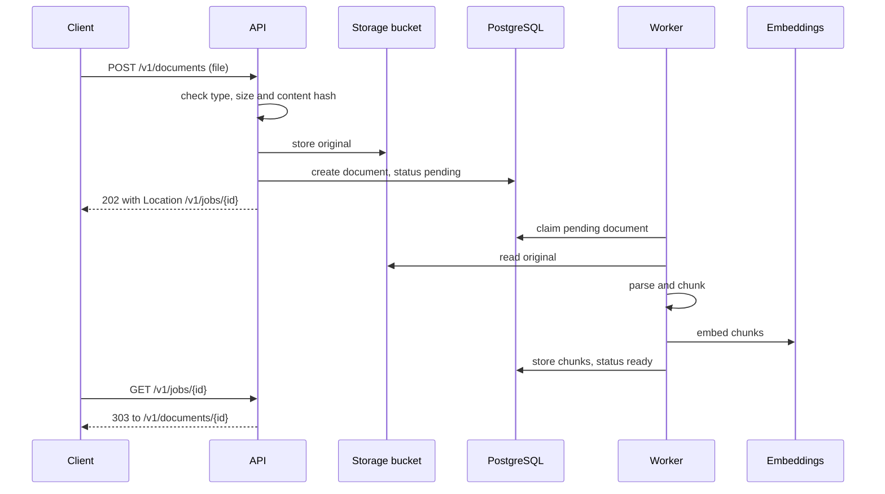

# rag

A document ingestion service for retrieval-augmented generation. Upload PDF, DOCX, plain text or Markdown files over HTTP. The service stores the original, extracts the text, splits it into chunks, embeds the chunks and saves them in PostgreSQL with pgvector, all in the background with a status you can poll.

**Status:** ingestion and document management are built. Retrieval, answering and authentication are not built yet.

## Features

- Upload PDF (text layer), DOCX, TXT and Markdown files
- File type detected from the file content and checked against the extension
- Background ingestion that survives restarts, with `pending`, `processing`, `ready` and `failed` document states
- Duplicate detection by file content, so the same file is never ingested twice
- Originals kept in a private Supabase Storage bucket
- Hybrid-search-ready schema: vector column with an HNSW cosine index and a full-text column with a GIN index
- Configurable limits for upload size, PDF pages, extracted text and DOCX expansion
- Versioned API under `/v1`: uploads return `202` with a job to poll, lists use cursors, and a retried upload can carry an `Idempotency-Key`
- Every error is an RFC 9457 `application/problem+json` document, with no internal detail on server errors
- Embeddings from Jina or a local sentence-transformers model, behind one interface

## How it works



The worker claims documents with row locking, so several instances can run without processing the same document twice. A document left in `processing` after a crash is reclaimed after a timeout.

## Requirements

- Python 3.11 or newer and [uv](https://docs.astral.sh/uv/)
- A PostgreSQL database with the `pgvector` extension, such as a Supabase project
- A Supabase project for file storage
- A [Jina](https://jina.ai) API key, or a machine that can run the local embedding model

## Quick start

```bash
git clone https://github.com/manohar-kumar1/rag.git
cd rag
cp .env.example .env
uv sync
```

Fill every variable in `.env` (see [Configuration](#configuration)), then prepare the database and storage and start the service:

```bash
uv run python -m app.db.migrate
uv run python -m app.storage.setup
uv run uvicorn app.main:app --reload
```

Open `http://localhost:8000/docs` for the interactive API description. Set `WORKER_ENABLED=true` so uploaded documents are ingested.

## Configuration

All settings come from environment variables or a `.env` file. Every variable is required except the two Anthropic ones, and none has a built-in default, so the service refuses to start when one is missing or invalid.

### Database

| Variable | Description |
|---|---|
| `DATABASE_URL` | PostgreSQL connection string. Use a direct or session-mode connection, not transaction mode |
| `DB_POOL_MIN_SIZE` | Smallest number of pooled connections |
| `DB_POOL_MAX_SIZE` | Largest number of pooled connections |
| `DB_POOL_MAX_LIFETIME_SECONDS` | Connections older than this are replaced |
| `DB_POOL_TIMEOUT_SECONDS` | How long to wait for a connection and for the pool to open |

### Embeddings

| Variable | Description |
|---|---|
| `EMBEDDING_PROVIDER` | `jina` or `local` |
| `EMBEDDING_MODEL` | Model name for the chosen provider |
| `EMBEDDING_DIMENSION` | Vector size. Must match the database column. At most 2000 |
| `JINA_API_KEY` | Jina API key |
| `JINA_BASE_URL` | Jina API base URL |
| `JINA_BATCH_SIZE` | Chunks sent per request |
| `JINA_MAX_RETRIES` | Retries on rate limits and server errors |
| `JINA_RETRY_BACKOFF_SECONDS` | First retry delay, doubled each attempt |
| `JINA_TIMEOUT_SECONDS` | Request timeout |

Changing the embedding model or dimension means re-embedding every document.

### Ingestion and limits

| Variable | Description |
|---|---|
| `CHUNK_SIZE` | Characters per chunk |
| `CHUNK_OVERLAP` | Characters shared between neighbouring chunks. Must be smaller than the chunk size |
| `MAX_UPLOAD_BYTES` | Largest accepted upload, enforced before the file is fully read |
| `MAX_PDF_PAGES` | Most pages read from one PDF |
| `MAX_EXTRACTED_CHARS` | Most text kept from one document |
| `DOCX_MAX_UNCOMPRESSED_BYTES` | Largest size a DOCX may expand to |

### Storage

| Variable | Description |
|---|---|
| `SUPABASE_URL` | Supabase project URL |
| `SUPABASE_SECRET_KEY` | Server-side Supabase key. Never expose it to a browser |
| `STORAGE_BUCKET` | Name of the private bucket for original files |
| `STORAGE_TIMEOUT_SECONDS` | Storage request timeout |

### Worker and API

| Variable | Description |
|---|---|
| `WORKER_ENABLED` | Run the ingestion worker inside this process |
| `WORKER_POLL_INTERVAL_SECONDS` | How often the worker looks for pending documents |
| `WORKER_CONCURRENCY` | Documents processed at the same time per process |
| `WORKER_STALE_AFTER_SECONDS` | A `processing` document older than this is picked up again |
| `CORS_ORIGINS` | Comma-separated browser origins allowed to call the API |
| `DOCS_ENABLED` | Serve `/docs` and `/redoc`. Set `false` in production |
| `JOB_RETRY_AFTER_SECONDS` | Polling hint sent in the `Retry-After` header while a job is unfinished |
| `IDEMPOTENCY_TTL_SECONDS` | How long a finished `Idempotency-Key` is remembered |
| `IDEMPOTENCY_LOCK_SECONDS` | How long a key counts as in progress if the first request never finishes |

### Language models

| Variable | Description |
|---|---|
| `GOOGLE_API_KEY` | Google API key for the primary chat model |
| `GOOGLE_MODEL` | Primary chat model name |
| `GOOGLE_DECISION_MODEL` | Model used for routing decisions |
| `ANTHROPIC_API_KEY` | Optional. Enables the fallback chat model together with the model name |
| `ANTHROPIC_MODEL` | Optional. Fallback chat model name |

## API

Interactive documentation is served at `/docs` when `DOCS_ENABLED=true`, and the OpenAPI description at `/openapi.json`. Breaking changes get a new version prefix. Within `/v1` changes only add things.

| Method and path | Purpose | Success |
|---|---|---|
| `POST /v1/documents` | Upload a file as multipart form field `file`. Optional `Idempotency-Key` header | `202` with `Location` and `Retry-After`, or `200` if the same file already exists |
| `GET /v1/jobs/{id}` | Follow an ingestion job: `queued`, `parsing`, `embedding`, `done` or `failed` | `200` while unfinished or failed, `303` to the document when done |
| `GET /v1/documents` | List documents, newest first, with `limit` and an opaque `cursor` | `200` |
| `GET /v1/documents/{id}` | Get one document | `200` |
| `POST /v1/documents/{id}/retry` | Re-queue a `failed` document | `202` with `Location` |
| `DELETE /v1/documents/{id}` | Delete the document, its chunks and its stored original | `204` |
| `GET /healthz` | Liveness probe, checks nothing else | `200` |
| `GET /readyz` | Readiness probe, checks the database and storage | `200`, or `503` |

### Upload a document

```bash
curl -i -H "Idempotency-Key: 6f1c1d52-0a3e-4a58-9d63-3b0d6ac1c8a1" \
  -F "file=@report.pdf" http://localhost:8000/v1/documents
```

```http
HTTP/1.1 202 Accepted
Location: /v1/jobs/1
Retry-After: 2
X-Request-ID: 3f2a9c0e5c3d4f8aa1d0c64b9a7e1b22
```

```json
{
  "id": 1,
  "document_id": 1,
  "status": "queued",
  "error": null,
  "created_at": "2026-11-18T10:15:00Z",
  "processed_at": null,
  "already_existed": false
}
```

Sending the same key with the same file again replays this response with `Idempotent-Replayed: true`. The same key with a different file is a `422`, and a retry while the first request is still running is a `409`. A failed request releases its key, so the client can fix the file and retry with the same key.

Poll the job named by the `Location` header, no faster than its `Retry-After`. The job is `200` with `queued`, `parsing` or `embedding` while it runs. When it is done the job answers `303` with the document in `Location`, which browsers follow on their own. A `failed` job stays `200` and carries a short `error`. Retry it with `POST /v1/documents/{id}/retry`.

Two job statuses are not the document's own: `queued` is the document's `pending`, `parsing` and `embedding` are its `processing`, and `done` is its `ready`.

### Document fields

| Field | Description |
|---|---|
| `id` | Document id |
| `source` | Name the document was uploaded under |
| `status` | `pending`, `processing`, `ready` or `failed` |
| `error` | Reason when `failed`, otherwise `null` |
| `original_filename` | Uploaded file name, kept as metadata only |
| `content_type` | Type detected from the file content |
| `size_bytes` | Bytes uploaded |
| `created_at` | Upload time |
| `processed_at` | When ingestion finished, otherwise `null` |

### Errors

Every error is an [RFC 9457](https://www.rfc-editor.org/rfc/rfc9457) problem document with the media type `application/problem+json`:

```json
{
  "type": "urn:rag:problem:unsupported_file_type",
  "title": "Unsupported Media Type",
  "status": 415,
  "detail": "file content does not match its extension",
  "instance": "/v1/documents",
  "code": "unsupported_file_type",
  "request_id": "3f2a9c0e5c3d4f8aa1d0c64b9a7e1b22"
}
```

`code` is a stable machine-readable value to branch on. `request_id` matches the `X-Request-ID` response header and the server logs. Send your own `X-Request-ID` (letters, digits, `.`, `_`, `-`, up to 64 characters) to correlate calls. Validation errors add an `errors` list with the location and message of each problem and never repeat what was sent. Server-side failures return a generic `detail`, and the real cause goes to the logs.

| Status | Meaning |
|---|---|
| `400` | The request is invalid, for example the file name is missing or the cursor is not valid |
| `404` | The document or job does not exist |
| `409` | The document is in the wrong state, or the idempotency key is still being processed |
| `413` | The file exceeds the upload limit |
| `415` | The file type is not supported or does not match its extension |
| `422` | The request failed validation, or the idempotency key was used with a different file |
| `502` | A backing service such as storage or embeddings failed |
| `503` | A required dependency is unavailable. `/readyz` names which one |

## Supported files

| Type | Extension | Notes |
|---|---|---|
| PDF | `.pdf` | Needs a text layer. Scanned PDFs have no extractable text and end as `failed` |
| Word | `.docx` | Paragraphs and tables, in reading order |
| Text | `.txt`, `.md` | UTF-8 only |

Password-protected PDFs, legacy `.doc` files, images and OCR are not supported.

## Operations

### Database migrations

```bash
uv run python -m app.db.migrate          # apply pending migrations
uv run python -m app.db.migrate status   # show applied and pending
uv run python -m app.db.migrate down     # roll back the latest
```

Migrations are tracked and take an advisory lock, so running `up` again changes nothing and two runs cannot collide. After applying, the command checks that the vector column matches `EMBEDDING_DIMENSION`.

### Storage bucket

```bash
uv run python -m app.storage.setup
```

Creates the private bucket if it is missing and refuses to continue if an existing bucket is public.

### Ingesting from the command line

```bash
uv run python -m app.ingestion.cli ./report.pdf
```

This writes to the database that `.env` points at.

### Running more than one instance

Each instance with `WORKER_ENABLED=true` runs its own worker, and row locking keeps them from claiming the same document. To scale the API without extra workers, leave the flag off on those instances.

## Production deployment

```bash
uv run python -m app.db.migrate
uv run python -m app.storage.setup
uv run uvicorn app.main:app --host 0.0.0.0 --port 8000
```

Checklist:

- Provide every variable through your host's secret store. Never commit `.env`
- Set `WORKER_ENABLED=true` on at least one instance
- Set `CORS_ORIGINS` to the exact origins of your frontend
- Use a direct or session-mode database connection
- Set `DOCS_ENABLED=false` so `/docs` and `/redoc` are not public
- Point load balancer liveness checks at `/healthz` and readiness checks at `/readyz`
- Put the service behind HTTPS and add authentication in front of it, because the API has none yet

## Security

- The storage bucket is private, and the service refuses a public bucket
- Row level security is enabled on the document tables, so Supabase's public data API cannot read them
- File types are detected from content, and uploads are limited by size, PDF pages, extracted text and DOCX expansion
- Stored file names are generated, and the uploaded name is kept as metadata only
- Error messages never contain document text, and server-side failures return a generic message
- Configuration has no defaults and no values are hardcoded

## Limitations

- Retrieval, answering and chat are not built yet
- There is no authentication or per-user access control yet
- Documents are shared by everyone who can reach the API
- Scanned and image-based documents are not supported
